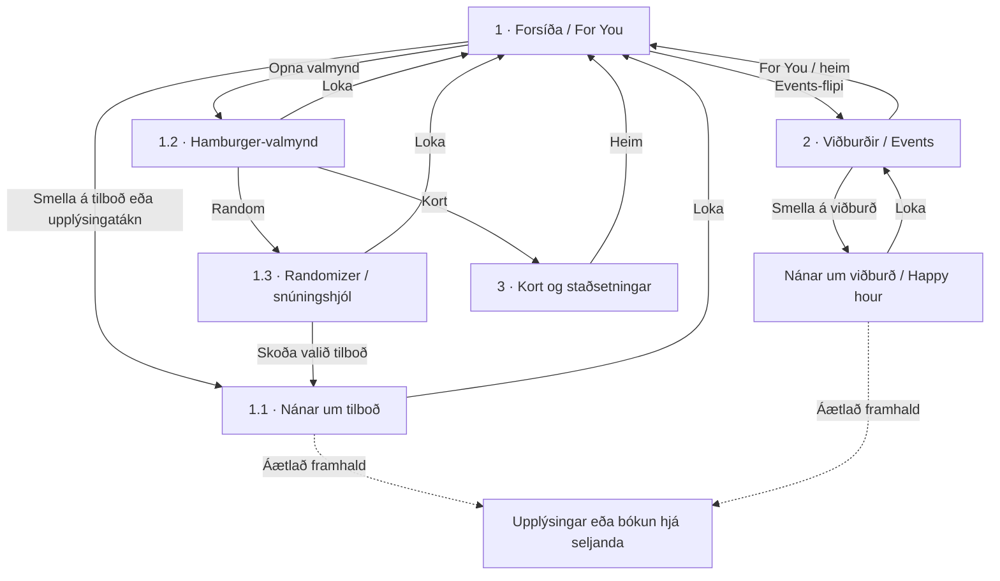

# Hvað á að gera.is

Vefverkefni í Vef-forritun 2 sem safnar saman tilboðum, viðburðum og afþreyingu á Íslandi. Notendur geta fundið eitthvað að gera í dag eða á næstu dögum, vistað hugmyndir og farið áfram á upplýsingasíðu eða bókun hjá seljanda.

Vefsíðan er byggð með **Next.js** og notar **SQLite** til að geyma gögn. Gögnum er safnað af vefsíðum með Node.js og Cheerio. Viðmótið er hannað fyrst fyrir síma og aðlagast stærri skjám.

## Uppsetning

**Forsendur:** Node.js 22 eða nýrra og npm.

```bash
npm install
```

Búðu til staðbundna stillingaskrá úr `.env.example`:

```bash
# macOS / Linux
cp .env.example .env.local
```

```powershell
# Windows / PowerShell
Copy-Item .env.example .env.local
```

Safnaðu gögnum og ræstu þróunarþjóninn:

```bash
npm run scrape
npm run dev
```

Opnaðu síðan [localhost:3000](http://localhost:3000).

### Skipanir

| Skipun | Lýsing |
| --- | --- |
| `npm run dev` | Ræsir þróunarþjón Next.js. |
| `npm run scrape` | Keyrir alla gagnasafnara og vistar niðurstöður í gagnagrunninn. |
| `npm run scrape -- tix` | Keyrir einn gagnasafnara, hér `tix`. |
| `npm run build` | Byggir verkefnið fyrir rekstur. |
| `npm start` | Ræsir byggðu útgáfuna. |
| `npm run lint` | Keyrir ESLint. |
| `npm run typecheck` | Athugar TypeScript-týpur. |

Dæmi um einstaka gagnasafnara: `kvikmyndir`, `bioparadis`, `smarabio`, `tix`, `hopkaup`, `sundlaugar` og `happyhour`. Skráning gagnasafnara er í `scraper/sources/index.ts`.

## Síður og virkni

| Slóð | Síða | Innihald |
| --- | --- | --- |
| `/` | Í dag | Tilboð og viðburðir, afþreying, bíósýningar, hugmyndir, veitingastaðir, happy hour og sund. |
| `/events` | Viðburðir | Viðburðir næstu 60 daga, flokkaðir eftir degi. Fjöldaga viðburðir birtast á hverjum degi sem þeir standa yfir. |
| `/map` | Kort | OpenStreetMap-kort af landinu með stöðum, lituðum eftir tegund. Hver staður hefur einn kortapinna og upplýsingaglugga með því sem er í boði. |
| `/plan` | Planið | Atriði sem notandi hefur sett á planið eða vistað með hjarta. |

### Forsíðan

Forsíðan sýnir myndafærslur og minni efnishluta á milli þeirra: afþreyingu sem er opin, bíómyndir, eigin hugmyndir, veitingastaði í matgörðum, happy hour og sundlaugar. Þegar líður á kvöldið og dagskrá dagsins er lokið sýna viðeigandi hlutar morgundaginn, til dæmis „Í bíó á morgun“ og „Sund á morgun“.

Efnið má sía eftir aldri og flokkunum **Afþreying, Viðburðir, Tónlist, Bíó, Matur & drykkur, Sund** og **Hugmyndir**. Leitin fær fókus með `/`, og „Veldu fyrir mig“ velur atriði af handahófi.

### Viðburðir og kort

Viðburðasíðan býður upp á aldurssíu, tegundarsíu (**Allt / Tónlist**), dagasíur (**Í dag, Á morgun, Um helgina, Næstu 7 daga**) og dagatal undir „Velja dag“. Slóðin `/events?tegund=tonlist` opnar síðuna með tónlistarsíuna virka.

Kortið sýnir meðal annars viðburðastaði, sundlaugar, bari og afþreyingu. Þar er hægt að sía eftir aldri og tegund. Staðir með heimilisfang en án hnita birtast í lista án kortapinna; það á meðal annars við um margar sundlaugar.

### Vistun

„Vista“, „Á planið“ og valinn aldurshópur eru geymd í vafranum með `localStorage`. Notandaaðgangur er því ekki nauðsynlegur í núverandi útgáfu.

## Hönnun og verkaskipting

Útlitið byggir á fyrri hugmyndavinnu: leiðsögn til hliðar á tölvum, neðri valmynd á símum og myndaflæði með hliðardálki. Hugmyndir og skissur eru varðveittar á greininni `concept`.

Núverandi stíll notar hlýjan ljósan bakgrunn, kóralrauðan áherslulit og leturgerðina Schibsted Grotesk. Litir eru skilgreindir efst í `src/styles/shared.css` til að auðvelda breytingar á þemanu.

Vinnan skiptist í þrjú svið: **gögn og gagnasöfnun, forsíðu og undirsíður**. Hvert svið hefur sínar möppur og stílsnið. Nánari verkaskipting er í [VERKASKIPTING.md](VERKASKIPTING.md).

### Uppbygging verkefnisins

| Skrá eða mappa | Hlutverk |
| --- | --- |
| `src/lib/feed.ts` | Breytir gagnagrunnsfærslum í `FeedItem` og forsníður texta og dagsetningar á þjóninum. Inniheldur einnig `isMusic`. |
| `src/lib/feed-types.ts` | Sameiginlegar týpur og aldurssíureglur, meðal annars `fitsAgeGroup`. |
| `src/lib/map.ts` | Hópar efni eftir stað fyrir kortið. Týpur eru í `map-types.ts`. |
| `src/lib/format.ts` | Forsníður íslenskar dagsetningar og verð án `Intl`, svo þjónn og vafri skili sama texta. |
| `src/lib/queries.ts` | SQL-fyrirspurnir vefsíðunnar. |
| `src/lib/db.ts` | Tengist gagnagrunninum og sér um sjálfvirkar dálkaviðbætur. |
| `src/lib/match.ts` | Samræmir titla til að sameina sömu kvikmynd úr fleiri heimildum. |
| `src/components/home/` | Forsíða: `Frontpage`, `PostCard` og eldri `Feed` með bíóhillu, staðalistum og hugmyndakortum. |
| `src/components/subpages/` | `EventsView`, `PlacesMap` og `PlanView`. |
| `src/components/shared/` | Sameiginlegir hlutar: haus, upplýsingagluggi, síur, tákn, verð og vistuð atriði. |
| `src/styles/` | `shared.css`, `home.css`, `events.css`, `map.css` og `plan.css`. Öll eru flutt inn í `src/app/layout.tsx`. |
| `scraper/sources/` | Gagnasafnarar, einn fyrir hverja vefsíðu. |
| `scraper/content/ideas.ts` | Handskrifaður hugmyndabanki. |
| `db/schema.sql` | Töflur og SQL-sýnir. |
| `data/hvad.db` | Staðbundinn SQLite-gagnagrunnur, undanskilinn Git. |

## Flokkun efnis

### Tónlist

Tónleikar eru viðburðir sem fá einnig flokkinn **Tónlist**. Á forsíðunni birtast tónleikar dagsins og morgundagsins með hlekk á alla tónleika. Á viðburðasíðunni er tónlist valin með tegundarsíunni.

Reglan `isMusic` í `src/lib/feed.ts` notar flokkun skipuleggjanda, til dæmis „Tónleikar“, „Tónlist“, „Rokk og popp“, „Klassík“, „Jazz og blús“, „Kór“ og „Ópera“. Viðburðir teljast einnig tónlist ef heitið inniheldur „tónleikar“. Söngleikir haldast í leikhúsflokki og barnaviðburðir teljast aðeins tónlist þegar um tónleika er að ræða.

### Aldur

Aldurssían er fyrir ofan forsíðuflæðið, viðburðalistann og kortið:

**Allir · 0–14 ára · Fjölskyldan · 15–19 ára · 20+**

Gagnasafnarinn vistar `items.min_age` og `items.audience`. Reglurnar eru í `scraper/lib/ages.ts`.

| Flokkun | Gögn sem liggja til grundvallar |
| --- | --- |
| Áfengistengt efni → 20+ | Happy hour og tilboð eða viðburðir þar sem heitið nefnir áfengi, svo sem bjór, vín, kokteil eða mímósu. |
| Aldurstakmörk | Lýsingar á tix.is, til dæmis „18 ára aldurstakmark“. Takmörkun sem á aðeins við kvöldsýningar er ekki látin gilda um allan viðburðinn. |
| Aldursmerkingar kvikmynda | Merkingar frá kvikmyndir.is og Smárabíó. Myndir leyfðar öllum eða frá 9 ára aldri og yngri teljast fjölskyldumyndir. Bíó Paradís fær merkingu sömu myndar frá kvikmyndir.is þegar hún finnst þar. |
| Barnaefni | Bókasafnsviðburðir í flokknum „Börn“. |
| Fjölskylduefni | Sundlaugar, afþreying, fjölskyldu- og barnaflokkar á tix.is, viðeigandi lýsingar og hugmyndir merktar `family: true`. |

| Aldurshópur | Hvað birtist? |
| --- | --- |
| Allir | Allt efni, án aldurssíunar. |
| 0–14 ára | Allt nema áfengistengt efni, efni með aldurstakmörk yfir 14 árum og kvikmyndir með óþekkta aldursmerkingu. |
| Fjölskyldan | Aðeins efni ætlað börnum eða fjölskyldum. |
| 15–19 ára | Allt nema efni eingöngu ætlað börnum og 20+ efni. Viðburðir með 18 ára aldurstakmark birtast merktir „18+“. |
| 20+ | Allt nema efni eingöngu ætlað börnum. |

Kort sýna merkingar eins og „20+“, „16+“ og „Börn“. Upplýsingaglugginn sýnir einnig aldursupplýsingar. Undir síunni kemur fram hversu mörg atriði eru falin, til dæmis „32 atriði falin. Sýna allt“, svo áhrif vistaðs síuvals séu sýnileg.

### Hugmyndabankinn

Í `scraper/content/ideas.ts` er handskrifaður listi af ókeypis eða ódýrum hugmyndum, svo sem gönguferðum, spilakvöldum, norðurljósaskoðun og bíókvöldi heima.

Hver hugmynd hefur titil, stutta lýsingu og merki, til dæmis `Frítt`, `Úti` eða `Vinahópur`. Einnig má skilgreina birtingarmánuði, `family: true` og hlekk. Skipunin `npm run scrape` hleður árstíðabundnum hugmyndum í gagnagrunninn. Þær birtast sem lituð kort í breytilegri röð eftir degi.

## Gögn og gagnasöfnun

Gögn fara úr heimildavefsíðum og hugmyndabankanum í gagnasafnara (`scraper/`), þaðan í SQLite (`data/hvad.db`) og síðan í gegnum SQL-sýnir og fyrirspurnir til Next.js-síðnanna.

### Gagnagrunnur

`db/schema.sql` skilgreinir töflurnar `sources`, `venues`, `items`, `occurrences` og `scrape_runs`, ásamt sýnunum `v_current_items`, `v_today`, `v_upcoming`, `v_open_soon` og `v_active_deals`. Skemað er keyrt þegar gagnagrunnurinn er opnaður og sýnir eru endurgerðir sjálfkrafa.

`v_current_items` birtir aðeins atriði sem sáust í síðustu vel heppnuðu söfnun viðkomandi heimildar. Ef atriði hverfur af upprunasíðu hverfur það því úr birtingu eftir næstu heppnuðu söfnun. Misheppnuð söfnun felur ekkert.

`scraper/lib/store.ts` bætir við nýjum færslum og uppfærir þær sem eru til. Endurtekin keyrsla á því ekki að búa til tvítekningar.

### Opnunartímar og samræming

- **Opnunartímar:** Vikulegir tímar sundlauga, happy hour og afþreyingarsvæðis Smárabíós eru færðir í tímaslot fyrir næstu sjö daga með `scraper/lib/schedule.ts`. Sýnin `v_open_soon` nær yfir staði sem eru opnir núna eða opna síðar í dag eða á morgun.
- **Kvikmyndir:** Sama mynd úr fleiri heimildum er sameinuð í eitt kort með samræmdum titli (`items.match_key` og `src/lib/match.ts`). Þetta nær meðal annars yfir „Iceguys – kvikmyndin“ / „IceGuys the Movie“ og „Fjörður (Fjord)“ / „Fjord“.
- **Staðsetningar:** Hnit eru sótt úr heimildunum sjálfum. tix.is birtir hnit staða, happyhour.is hefur þau í kortahlekkjum og sumar síður sundlaugar.is innihalda Google Plus Code sem `scraper/lib/geo.ts` afkóðar. Aðrir staðir hafa aðeins heimilisfang. Núverandi útfærsla notar ekki utanaðkomandi hnitaleitarþjónustu.
- **Hægari heimildir:** sundlaugar.is og ofurkaup.is geyma breytingaupplýsingar síðna í `items.version` til að forðast óþarfa endurlestra. Fyrsta keyrsla getur tekið nokkrar mínútur en síðari keyrslur eru hraðari.
- **Síun:** Viðburðasíðan sækir alla viðburði innan tímabilsins. Forsíðan sækir fleiri en hún birtir svo aldurssíur hafi úr nægu efni að velja.

### Heimildir

| Heimild | Gögn |
| --- | --- |
| kvikmyndir.is | Bíósýningar í dag og á morgun, miðakaupatenglar og aldursmerkingar. |
| bioparadis.is | Dagskrá Bíó Paradísar um sex daga fram í tímann, tungumál texta og merkingar hátíða eða sýningaraða. |
| smarabio.is | Bíósýningar næstu sjö daga, salir á borð við MAX og Lúxus og aldursmerkingar. Einnig Lasertag, Leiktækjasalur og Fótboltaland. |
| tix.is | Tónleikar, leikhús og aðrir viðburðir með dagsetningum, stöðum, heimilisföngum, hnitum, verði og aldurstakmörkum. Bæði forsíða og flokkasíður eru lesnar. |
| hopkaup.is | Tilboð á veitingum og afþreyingu, verð, fyrra verð og afsláttarhlutfall. |
| ofurkaup.is | Tilboð á veitingum, dekurþjónustu, afþreyingu og ferðum um landið. Vörutilboðum er sleppt. |
| reykjavik.is | Opnunartímar átta sundlauga Reykjavíkur, þar á meðal á frídögum, ásamt heimilisfangi, mynd og lýsingu. |
| sundlaugar.is | Sundlaugar, lón og náttúrulaugar um landið, um 100 staðir. Heimilisfang, landshluti, lýsing á stærð og mynd. Hnit aðeins þar sem kortakóði finnst; opnunartímar eru ekki sóttir. |
| happyhour.is | Happy hour-tímar, vikudagar, heimilisföng og hnit. |
| borgarbokasafn.is | Viðburðir Borgarbókasafnsins, svo sem föndurkvöld, ritlistasmiðjur, fyrirlestrar og sögustundir. |
| listasafnreykjavikur.is | Yfirstandandi sýningar í Hafnarhúsi, á Kjarvalsstöðum og í Ásmundarsafni ásamt opnunartímum. |
| skautaholl.is | Almennir skautatímar í Skautahöllinni í Laugardal. |
| smaralind.is | Opnunartímar Smáralindar og 13 veitingastaða í matgarðinum Garðinum. |
| kringlan.is | Opnunartímar Kringlunnar og upplýsingar um matgarðinn Kúmen. Verslana- og veitingastaðalistar úr `/api/` eru ekki sóttir vegna takmarkana í `robots.txt`. |
| keiluhollin.is | Opnunarupplýsingar Keiluhallarinnar í Egilshöll. Ef heimildin segir aðeins „Opið allan daginn“ er sá texti birtur. |
| klifurhusid.is | Opnunartímar Klifurhússins. |
| `scraper/content/ideas.ts` | Eigin hugmyndir verkefnisins; ekki sóttar af öðrum vefsíðum. |

Lasertag hefur eigin opnunartíma og upplýsingar um hópastærð. Leiktækjasalurinn hefur verðupplýsingar. Fótboltaland hefur ekki sérsíðu og fær því tíma afþreyingarsvæðisins; það er aðeins bætt við meðan þess er getið á vefnum.

### Að bæta við heimild

1. Athugaðu `robots.txt` og skilmála heimildarinnar.
2. Búðu til `scraper/sources/<name>.ts` sem flytur út `Source`; sjá `scraper/types.ts`.
3. Skráðu heimildina í `scraper/sources/index.ts`.
4. Haltu fjölda fyrirspurna í lágmarki og notaðu sameiginlega HTTP-hjálparann.

`scraper/lib/http.ts` virðir `robots.txt`, auðkennir safnarann með `SCRAPER_USER_AGENT` og bíður í `SCRAPER_DELAY_MS` milli fyrirspurna á sömu síðu.

Staði sem birta aðeins vikulega opnunartíma má bæta við í `scraper/sources/venues.ts` með vefslóð og textanum sem kemur rétt á undan tímunum.

### Breytingar á skema

`CREATE TABLE IF NOT EXISTS` breytir ekki töflum sem eru þegar til. Þegar dálki er bætt við þarf því að bæta honum í `ADDED_COLUMNS` í `src/lib/db.ts` svo eldri gagnagrunnar uppfærist. Þannig var meðal annars `min_age` og `audience` bætt við.

Annar kostur er að eyða staðbundna gagnagrunninum `data/hvad.db` og keyra `npm run scrape` aftur. Það endurskapar gögnin og eyðir fyrri staðbundnum gagnagrunnsfærslum.

## Stillingar og Git

- `.env.example` er sniðmát í Git og á aðeins að innihalda staðgengilsgildi.
- `.env.local` geymir raunveruleg staðbundin gildi, til dæmis API-lykla, og er undanskilin Git.
- `.gitignore` undanskilur `.env*` nema `.env.example`, auk `node_modules/`, `.next/`, gagnagrunnsskráa í `data/`, annála og ritilstillinga.
- Umhverfisbreytur án `NEXT_PUBLIC_` eru ætlaðar þjóninum. Leynigildi mega aldrei fara í breytur með `NEXT_PUBLIC_`, því þær geta borist í vafrann.
- `package-lock.json` er vistað í Git til að samræma útgáfur háðra pakka.

Fyrir innsendingu skaltu yfirfara `git status` og tryggja að `.env.local`, gagnagrunnar eða önnur staðbundin gögn séu ekki meðal breytinganna. Til að sjá hvað `git add` myndi bæta við, án þess að sviðsetja skrár:

```bash
git add --dry-run .
```

Hver þátttakandi keyrir `npm install` og `npm run scrape` til að setja upp eigin vinnuumhverfi og gagnagrunn.

## Eldri frumgerð og skissur

Áður en Next.js-útfærslan var gerð var búin til sjálfstæð HTML-frumgerð til að prófa útlit og flæði. Þessi hluti lýsir þeirri frumgerð og upprunalegu skissunum.

### HTML-frumgerð

`homepage.html` má opna beint í vafra. CSS, JavaScript og ljósmyndir eru innfelld og frumgerðin virkar án uppsetningar eða nettengingar. Tilboð, verð og viðburðir eru sýnigögn.

Forsíðan hefur valmynd vinstra megin, heiti í miðju, notandatákn hægra megin og flipana **For You / Events**. Tilboðskort sýna ljósmyndir með hvítum texta yfir svörtum litstigul.

Hægt er að skipta um tilboð með punktum eða stroku, opna nánari upplýsingar, fara í viðburði, opna valmynd og velja handahófskennt tilboð. Notandasvæðið og bókunarhnappurinn sýna dæmi um framhald. „Veldu fyrir mig“ velur beint; kort og snúningshjól eru ekki útfærð í þessari HTML-skrá.

### Myndrænt yfirlit

[wireframe.html](wireframe.html) sýnir sex símaútlit, tengingar þeirra, upprunalega skissu og tillögu að Next.js-uppbyggingu. Hnapparnir „Kynna flæðið“ og „Næsta skref“ leiða áhorfendur í gegnum hugmyndina; einnig má smella á hnappa í símunum. „Prenta / PDF“ opnar A3-prentsýn. Myndir eru innfelldar og yfirlitið virkar án nettengingar.

[wireframe-yfirlit.png](wireframe-yfirlit.png) er mynd af skjáunum sex og tengingum þeirra, ætluð í skýrslu eða glærur.

### Flæðirit skissunnar



### Tengsl skjáa

| Númer | Skjár | Hegðun samkvæmt skissum |
| --- | --- | --- |
| 1 | Forsíða / For You | Upphafssíða með tilboðum. |
| 1.1 | Nánar um tilboð | Gluggi yfir forsíðu með upplýsingum og fyrirhuguðum hlekk á seljanda. |
| 1.2 | Valmynd | Lag yfir forsíðu með leiðum í handahófsval og kort. |
| 1.3 | Handahófsval / snúningshjól | Gluggi yfir forsíðu; niðurstaðan leiðir í upplýsingar um valið tilboð. |
| 2 | Viðburðir / Events | Sérsíða með viðburðum og upplýsingagluggum, meðal annars fyrir happy hour. |
| 3 | Kort | Sérsíða með stöðum og staðsetningu notanda. |

Þegar glugga er lokað heldur notandinn áfram á síðunni undir honum. Hlekkir á upplýsingar eða bókun hjá seljanda voru fyrirhugað framhald. Atriði sem eru óljós á skissunum, svo sem nákvæm hegðun viðburðaglugga, eru túlkun á tengslunum.

### Myndir úr skissuvinnu

Númerin vísa í röð myndanna tíu sem fylgdu upphaflegri hugmyndavinnu.

| Mynd | Innihald |
| --- | --- |
| 1, 2 og 4 | Yfirlit yfir síður 1–3 og glugga 1.1–1.3; örvar sýna flakkið. |
| 3 | Nærmynd af viðburðasíðu 2 með heim-hnappi. |
| 5 | Nærmynd af korti 3 með stöðum og staðsetningu notanda. |
| 6 | Nærmynd af snúningshjóli 1.3 með snúnings- og lokunarhnappi. |
| 7 | Upplýsingagluggi fyrir happy hour yfir efnislista. |
| 8 | Nærmynd af valmynd 1.2 með Random og Kort. |
| 9 | Víðara yfirlit yfir skissurnar, meðal annars happy hour-gluggann. |
| 10 / `homepage.png` | Nærmynd af forsíðu 1; grunnur HTML-frumgerðarinnar. |
