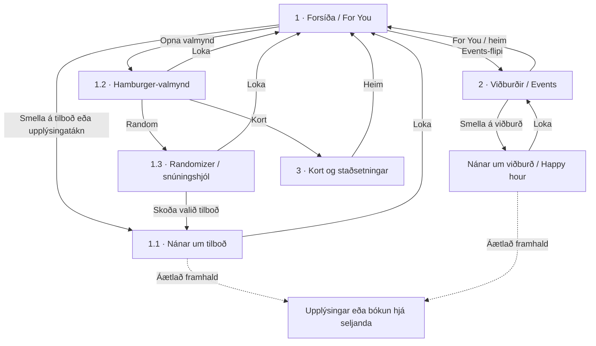

# Vef-Forritun2-Website
Hvað á að gera í dag? Vefsíða
# Hvað á að gera.is

Mobile-first frumgerð af síðu sem safnar saman tilboðum, viðburðum og afþreyingu. Markmiðið er að finna eitthvað að gera og fara þaðan áfram á upplýsingasíðu eða bókun hjá seljanda.

Opnaðu `homepage.html` beint í vafra. CSS, JavaScript og ljósmyndir eru innfelld í skránni; engin uppsetning eða nettenging þarf.

## Myndrænt yfirlit fyrir kynningu

Opnaðu [wireframe.html](wireframe.html) til að sjá sex símaútlit, örvar milli skjáa, upprunalega skissu og tillögu að Next.js-uppbyggingu. Notaðu „Kynna flæðið“ / „Næsta skref“ til að leiða áhorfendur í gegnum hugmyndina eða smelltu á hnappa í símunum. „Prenta / PDF“ opnar prentsýn í A3. Myndir eru innfelldar og yfirlitið virkar án nettengingar.

Yfirlitið er hönnunar- og flæðistillaga að heildinni; virkni keyranlegu forsíðunnar er lýst hér að neðan.

[wireframe-yfirlit.png](wireframe-yfirlit.png) er mynd af skjáunum sex og tengingunum, tilbúin í skýrslu eða glærur.

## Fyrirhuguð útfærsla

Verkefnið verður þróað í **Next.js**. Önnur söfn (libraries) verða mögulega notuð og valin eftir þörfum; þau hafa ekki verið ákveðin enn. HTML-skráin er sjálfstæð frumgerð til að prófa útlit og flæði áður en það er útfært í Next.js.

## Frumgerðin

Forsíðan fylgir uppsetningu teikningarinnar: valmynd vinstra megin, heiti í miðju, notandatákn hægra megin og **For You / Events** flipar. Tilboðskort sýna ljósmyndir með hvítum texta yfir svörtum litstigul sem dofnar upp í myndina.

Virkni í þessari útgáfu: skipta um tilboð með punktum eða stroku, opna nánari upplýsingar, skipta yfir í viðburði, opna valmynd og velja handahófskennt tilboð. Notandasvæðið og bókunarhnappurinn sýna aðeins dæmi um framhaldið. Öll tilboð, verð og viðburðir eru sýnigögn.

## Hvernig teikningarnar tengjast

**1** er forsíðan. **1.1–1.3** eru gluggar eða lög yfir henni. **2** er viðburðasíðan og **3** er kortið. Þegar glugga er lokað heldur notandinn áfram á síðunni undir honum.

Kortið og snúningshjólið eru hluti af fyrirhugaðri heild samkvæmt teikningunum. Í `homepage.html` velur „Veldu fyrir mig“ tilboð beint; þar er hvorki kort né snúningshjól enn komið.

## Hvaða mynd sýnir hvað?

Númerin vísa í röð myndanna tíu sem voru sendar í samtalinu.

| Mynd | Innihald og tenging |
| --- | --- |
| 1, 2 og 4 | Yfirlit yfir síður 1, 2 og 3 og gluggana 1.1–1.3; örvar sýna flakkið. |
| 3 | Nærmynd af síðu 2: viðburðalisti með heim-hnappi. |
| 5 | Nærmynd af síðu 3: kort með stöðum og staðsetningu notanda. |
| 6 | Nærmynd af 1.3: snúningshjól yfir forsíðunni, snúningshnappur og lokun. |
| 7 | Dæmi um upplýsingaglugga fyrir Happy hour yfir lista af efni. |
| 8 | Nærmynd af 1.2: valmynd yfir forsíðunni, með Random og Kort. |
| 9 | Víðara yfirlit yfir teikningarnar, þar á meðal Happy hour-gluggann. |
| 10 / homepage.png | Nærmynd af forsíðu 1; grunnurinn að núverandi uppsetningu. |

Flæðiritið lýsir fyrirhugaðri heild. Smáatriði sem eru óljós á skissunum, svo sem nákvæm hegðun upplýsingaglugga fyrir viðburði, eru túlkun á tengslunum.
